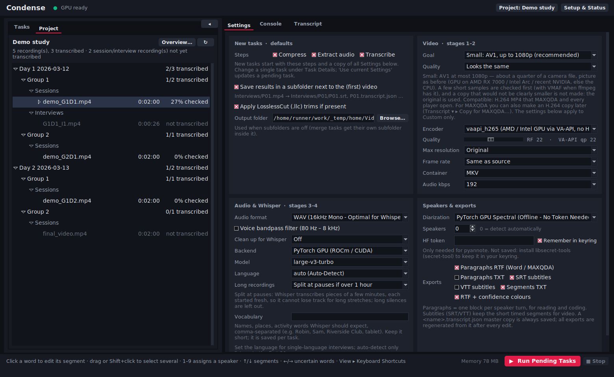
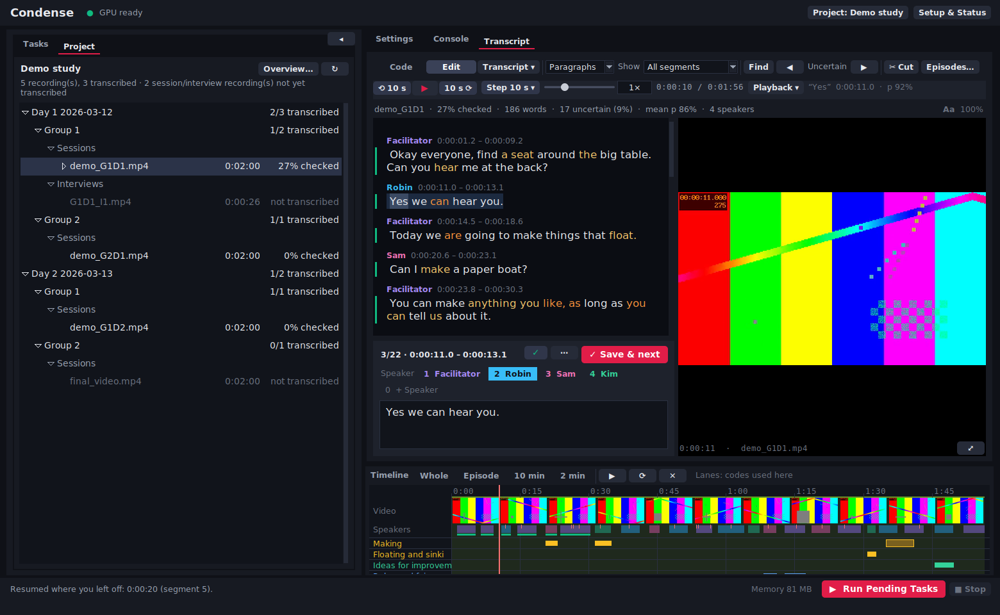
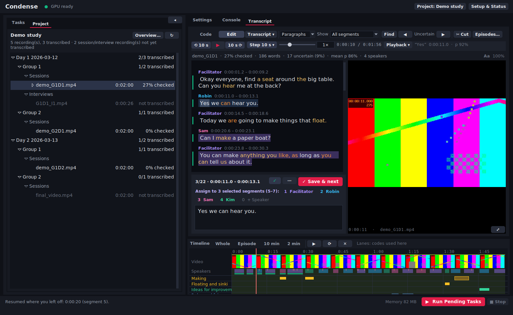
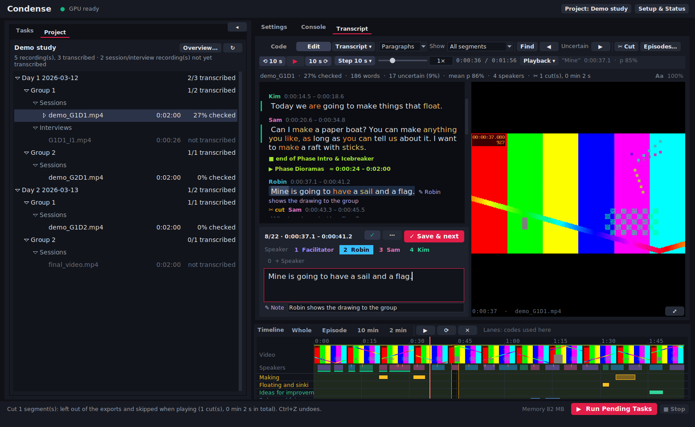
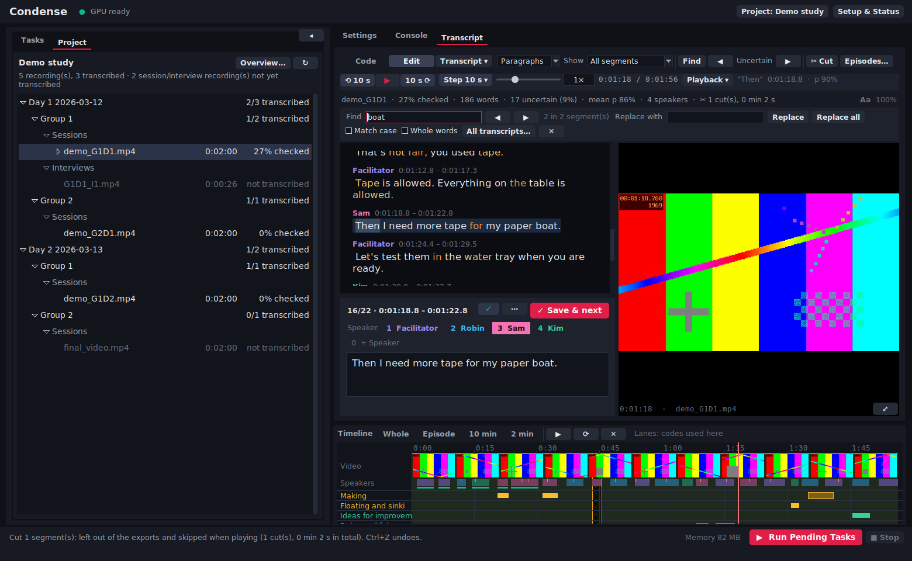
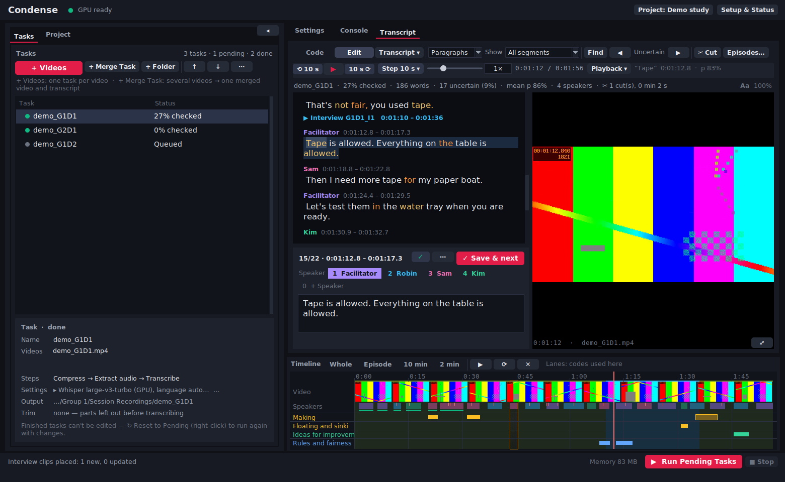
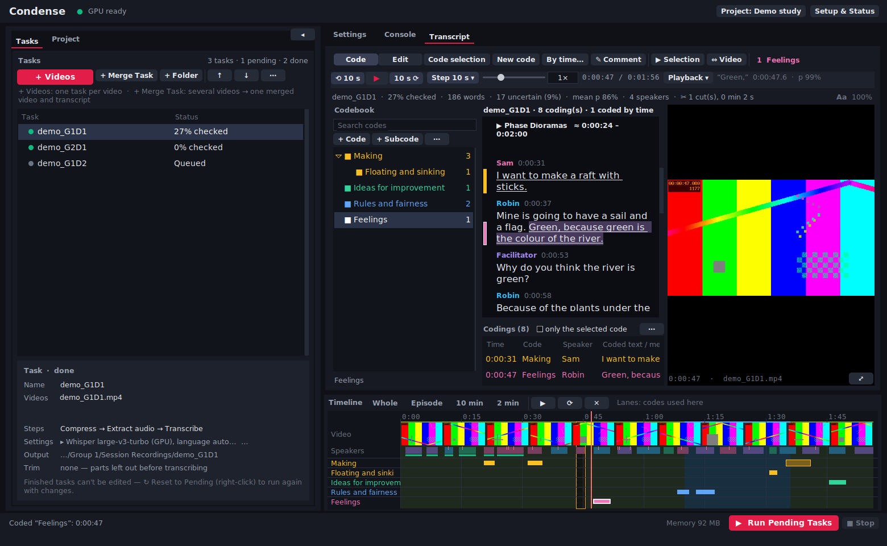
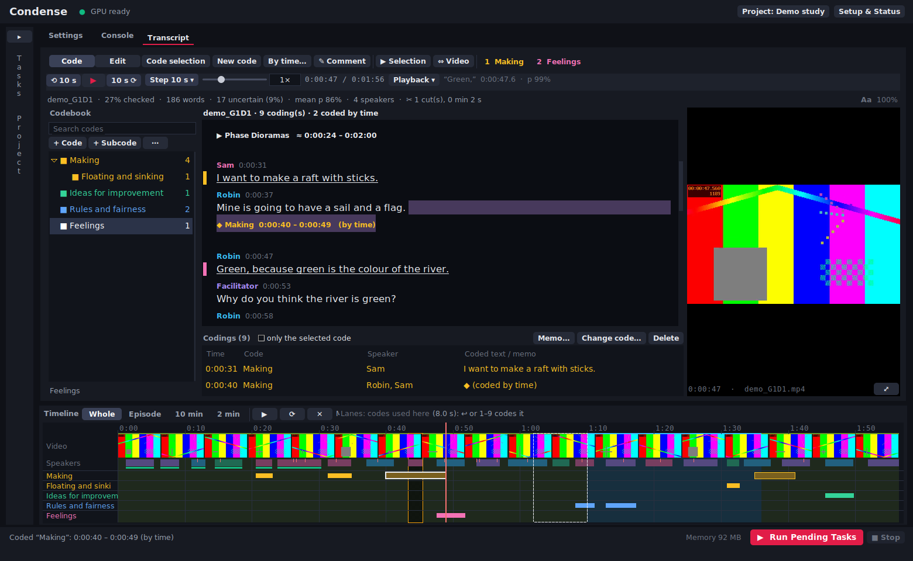
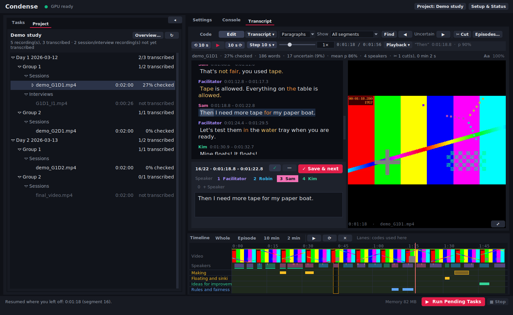

# Condense user guide

From recordings to a checked transcript in MAXQDA. Every picture shows invented demo data: a test pattern instead of
a video, made-up dialogue and the stand-in names Robin, Sam and Kim.

Shortcuts are written **Mac / Linux and Windows**, for example **⌘↩ / Ctrl+Enter**. *View ▸ Keyboard Shortcuts*
(⌘/ or Ctrl+/) lists them all for your system.

**Contents:**
1. [Install and update](#1-install-and-update)
2. [From recording to transcript](#2-from-recording-to-transcript)
3. [Trim before transcribing](#3-trim-before-transcribing)
4. [Reviewing a transcript](#4-reviewing-a-transcript)
5. [Speakers](#5-speakers)
6. [Notes, find and replace, filters](#6-notes-find-and-replace-filters)
7. [Cutting parts out](#7-cutting-parts-out)
8. [Episodes: interviews and activity phases](#8-episodes-interviews-and-activity-phases)
9. [Coding](#9-coding)
10. [Projects: many sessions of one study](#10-projects-many-sessions-of-one-study)
11. [Into MAXQDA](#11-into-maxqda)
12. [Your data](#12-your-data)
13. [When something goes wrong](#13-when-something-goes-wrong)

---

## 1. Install and update

The install guides cover one-line installation for [macOS](install-mac.md), [Linux](install-linux.md) and
[Windows](install-windows.md).

- **Updates:** Condense checks once a day and offers new versions. To check by hand, use *Help ▸ Check for Updates…*
  (on the Mac, *Condense ▸ Check for Updates…*). It updates itself and restarts. You can turn the daily check off in
  the same menu.
- **Is the GPU working?** *Help ▸ Test GPU…* runs a short calculation on the graphics card and tells you whether
  Whisper will use it. Run it once after installing. Without a GPU, a one-hour recording can take hours instead of minutes.
  Condense also warns you before a run if the GPU is not usable.

## 2. From recording to transcript



1. **Add videos** (⌘O / Ctrl+O, or *+ Videos*): each video becomes one task. A session that was recorded as several
   clips (a camera that splits files) becomes one task with *+ Merge Task*: the clips are joined and you get a single
   transcript.
2. **Check the settings** (right). New tasks copy them, and each task keeps its own copy. *Task Details* (below the
   queue) shows a task's settings; *Use current Settings* updates a pending task. The settings that matter most:
   - **Steps:** *Compress* makes a smaller copy of the video to work with and to keep. *Extract audio* keeps a separate
     audio file. *Transcribe* runs Whisper.
   - **Video ▸ Goal:** *Small: AV1, up to 1080p* (the default) makes the copy several times smaller than a camera file
     (often a quarter of the size or less) with the picture as before. It uses the GPU where it can
     encode AV1 (AMD RX 7000, Intel Arc, recent NVIDIA), otherwise the CPU (Macs: their chips have no AV1 encoder; about
     an hour or two for 5 hours of video). Before encoding, a few short samples are made to estimate the size (and, when
     ffmpeg has VMAF, to find the smallest setting that still looks the same); if a copy would not be clearly smaller,
     none is made and the original is used. *Compatible: H.264 MP4* plays everywhere, MAXQDA included, but is larger.
     *Custom* uses the encoder settings below it, as before.
   - **Model:** `large-v3-turbo` is a good default. `large-v3` is slower and sometimes better with quiet or unclear
     speech.
   - **Language:** set it for single-language sessions. *Auto* only listens to the first 30 seconds.
   - **Vocabulary:** names, places and activity words Whisper should expect (`Robin, Sam, Riverside Club, papier-mâché`).
   - **Long recordings:** Whisper can lose track over hours and skip or repeat long stretches. *Split at pauses if over
     1 hour* (the default) transcribes such recordings in pieces of a few minutes, cut in pauses, each started fresh with
     your vocabulary, so an error stays inside its piece. Long silences are left out; anything with sound is transcribed.
   - **Clean up for Whisper:** *Level quiet voices* helps with soft-spoken children. *Reduce noise + level voices* also
     helps in noisy rooms. Only what Whisper hears is cleaned; your video and audio stay as they are.
   - **Diarization / Speakers:** detects who speaks when. You get `SPEAKER_00`, `SPEAKER_01`, … and give them names
     afterwards (see [Speakers](#5-speakers)). If you know the number of speakers, enter it.
   - **Exports:** keep *Paragraphs RTF* on for MAXQDA.
3. **Run** (⌘R / Ctrl+R, or *Run Pending Tasks*). The *Console* tab shows each step. You can keep working on other
   transcripts while it runs.

Results go into a subfolder next to the video (`Interviews/P01.mp4` → `Interviews/P01/`), or into the output folder
you chose:

| File | What it is |
|---|---|
| `P01.transcript.json` | The master file: every word with its timing and confidence, speakers, notes, cuts, the settings, tool versions, checksums and a log of every edit. Everything else is generated from it. |
| `P01_paragraphs.rtf` / `.txt` | One paragraph per speaker turn, with a timestamp at the end of each. **For MAXQDA** and Word. |
| `P01.srt` / `.vtt` | Subtitles. |
| `P01.txt` | Plain text by segment. |
| `P01_confidence.rtf` | The transcript with words coloured by how sure Whisper was. Useful for spotting problems. |

The exports are rewritten every time you save a change in the editor.

## 3. Trim before transcribing

Setup time, breaks and the minutes after the session usually don't belong in the transcript. Select the task, then
use *Task Details ▸ Trim…*:


Click the frame strip to move through the video (← / → step 1 s, ⇧ 10 s; Space plays 5 s). Mark a part to leave out
with *Cut starts here* (**I**) and *Cut ends here* (**O**). *Save* writes a LosslessCut project (`.llc`) next to the
video. You can also make one in
[LosslessCut](https://github.com/mifi/lossless-cut) itself. With *Apply LosslessCut (.llc) trims* on in Settings, the
marked parts are skipped before transcribing, and the shortened video is kept next to the transcript so that its
timestamps match.

You can also cut parts out after transcribing (see [Cutting parts out](#7-cutting-parts-out)).

## 4. Reviewing a transcript

Open a finished task (click it in the queue) or *File ▸ Open Transcript…* (⇧⌘O / Ctrl+Shift+O). The *Transcript*
tab opens. It has two modes, switched with **Code | Edit** at the left of its toolbar or **⌘E / Ctrl+E**: *Edit* for
reviewing (below) and *Code* for coding ([Coding](#9-coding)). Switching keeps your place, the video and the timeline.



- **Top:** the player and the video.
- **Under the tab:** the **timeline**, in both modes (see *Coding video on the timeline*):
  frames of the video, one colour per speaker, red ticks for uncertain words, a green bar under checked segments, cut
  parts hatched, episodes behind, and the codings in their lanes. Drag the line above it to give it more or less room.
- **Middle:** the transcript. Click a word to jump there; double-click to play from it. Words Whisper was unsure
  about are coloured: yellow, then orange, then red and underlined for the least certain.
- **Bottom:** the segment editor. It shows exactly the highlighted segment. Correct the text while listening.
  Unchanged words keep their exact timing. Every change is saved, logged and can be undone (⌘Z / Ctrl+Z).

**The controls, from top to bottom:** *Transcript ▾* (open, speakers, episodes, exports, mark all checked), the view
(*Paragraphs*/*Segments*), the *Show* filter, *Find*, ◀ *Uncertain* ▶, *✂ Cut* and *Episodes…* — on one row: what doesn't
fit in a narrow window is in the **⋯** menu at its end; then the player: ⟲ back, ▶ play, forward ⟳ by a **step** you choose
once under *Step ▾* (5, 10, 15 or 30 s; remembered), with *Playback ▾* for its options (follow the text, play a snippet when jumping, skip cuts, show the video, open in a video
player); in the segment editor's row ✓ (checked: green), *Split*, *Merge*, *Insert*, *Delete*, **⋯** (save, revert,
re-transcribe, markers) and *Save & next*, with the speakers under it: the segment's speaker is filled, a click (or its
number) gives the segment another one. Buttons say what they do; hover over one for its key.

**The video** fills its column: drag the column's edge to make it larger, or press **⤢** to give it a window of its
own (resize it, move it to a second screen, **F** or double-click for full screen; *Back into the window* returns it).
*Playback ▾ ▸ Sharper preview* decodes the camera's original recording instead of the compressed copy, when the
transcript is on the original's timeline (not trimmed or merged) — sharper, a little heavier for the computer.

**Long sessions:** hover over the timeline to see the time under the mouse, drag the playhead (or the ruler, when the
whole recording is shown) to scrub (Condense jumps when you let go; a drag elsewhere marks a range to code), zoom in (− / + or the wheel with ⌘ / Ctrl), or press ⌘J / Ctrl+J and type a time
such as `2:15:30`. For sessions over about an hour the
exports are updated in the background a moment after each change.

**No video next to the transcript?** That happens when the recording was trimmed (LosslessCut) and transcribed without
*Compress* in an older version, when the video was moved or renamed, or when the picture comes from a separate camera.
Choose *Link a video…* in the empty video panel (or *Playback ▾ ▸ Link a video…*) and pick the video. Condense finds
where the transcript's sound is in it and shows the matching picture: for a LosslessCut-trimmed transcript, the parts of
the original recording that were kept; for a camera that started earlier or later, the same moment. Nothing is
re-encoded and the video file is not changed; the link is saved in the transcript (undo works, *Unlink the video* removes
it). Where the linked video has no picture for a moment, the panel says so. *Export trimmed video & transcript…* only
uses a linked video if it is on the transcript's own timeline; otherwise it cuts the transcript's audio.

**A fast review loop:** click into the transcript, then

| Key | |
|---|---|
| **Space** / **Esc** | play / pause |
| **R** | replay the segment |
| **↑ / ↓** | previous / next segment |
| **← / →** | previous / next uncertain word |
| **Return** | edit the segment's text; **Esc** (or Tab) saves and takes you back to the transcript |
| **⌘↩ / Ctrl+Enter** | save, mark checked, go to the next segment (also while typing) |
| **C** | mark checked / not checked |
| **S** / **M** / **I** | split before the selected word / merge with the next segment / insert a segment |
| **Delete** (⌫ on the Mac) | delete the open segment (asks first) |
| **1 – 9** | assign speaker 1–9 |
| **N** | a note on the segment |
| ⌘[ ⌘] / Ctrl+[ Ctrl+] | back / forward one step (5–30 s, *Step ▾* or *Player ▸ Step*) |
| ⇧⌘[ ⇧⌘] / Ctrl+Shift+[ Ctrl+Shift+] | back / forward three steps |
| ⌘⇧. ⌘⇧, / Ctrl+Shift+. Ctrl+Shift+, | faster / slower |

**Text size:** click **Aa 100 %** to the right, above the transcript, for larger, smaller or the default size of the transcript and the segment box (80–250 %), as do Ctrl/⌘ + scroll wheel over the transcript and *View ▸ Larger / Smaller Transcript Text*. It is remembered. *View ▸ Larger / Smaller Text* (⌘+ / Ctrl++) sizes the whole window.

The line above the transcript shows how much is **checked**. Checked segments get a thin green bar in the margin beside
their lines, and the queue shows the
percentage for each task. Condense remembers where you stopped in each transcript. If you reviewed a transcript elsewhere, right-click it in the Project tab or the task list and choose *Mark All Checked (100 %)* (or use the Edit menu); ⌘Z / Ctrl+Z undoes it.

**Markers** for things Whisper can't write: *⋯ ▸ Insert marker* in the editor, or while typing ⌃L ⌃I ⌃U ⌃C ⌃P ⌃G ⌃N on the Mac
and Ctrl+Shift+L, I, U, C, P, G, N on Linux and Windows. They insert `[laughs]`, `[inaudible 0:12:31]`, `[unclear: ]`,
`[crosstalk]`, `[pause]`, `[German]` and `[gestures]`.

**When Whisper got a passage badly wrong** (mumbling, a switch of language): highlight it and right-click ▸
*Re-transcribe this passage…* (the times of what you highlighted are filled in), or use *Edit ▸ Re-transcribe
Passage…* (⌘⇧R / Ctrl+Shift+R), with a bigger model or a forced language.

**When Whisper skipped something:** *Transcript ▾ ▸ Find untranscribed stretches…* lists the stretches where the
recording has voices as loud as the transcribed talk but the transcript has nothing. Listen to them, then
*Re-transcribe selected (or all)*: they are transcribed one after another with the transcript's model, language and
vocabulary, each one undo step. *Split* (S), *Merge* (M), *Insert* (I) and *Delete* in the editor fix
the segmentation; *⋯ ▸ Revert my changes* undoes yours.


## 5. Speakers

The chips under the editor are the speakers. Their numbers are the keys:

- **One segment:** click it and press its speaker's number. While typing in the editor, use ⌃1–9 on the Mac and
  Alt+1–9 on Linux and Windows.
- **A whole stretch:** drag across the transcript, ⇧-click / Shift+click, or ⇧↓ / Shift+↓. Then press the number.
  It is one change, and one undo.

  

- **Who is who?** Speaker detection labels voices `SPEAKER_00`, `SPEAKER_01` … While such labels are left, a yellow
  **Who is who?…** chip appears next to the speakers. It lists each label with how much it speaks, a typical line and
  ▶ *Listen*; choose the name (one of your saved speakers, or type one) and all of its segments get it. Two labels can
  get the same name, when detection split one person in two. Quicker for a single label: **right-click its chip ▸ All
  segments of SPEAKER_01 are… Robin**. One undo step either way.
- **0** adds a new speaker and assigns it.
- **Transcript ▾ ▸ Speakers…** renames speakers everywhere in the transcript and its exports, for example
  `SPEAKER_01` → `Robin`. It also adds and removes speakers. Swapping two names works.

  

- **Transcript ▾ ▸ Detect speakers…** runs speaker detection again (for example with a different number of speakers). It keeps the
  speakers you assigned by hand.
- **For one stretch only:** highlight it in the transcript (from a word in its first segment to one in its last), then
  **right-click ▸ Detect speakers in this passage…**. Only those segments get new speakers, matched to the names already
  used there — handy in a long session where one part (a group discussion, say) needs separating.

Use pseudonyms here, not children's real names: the names end up in every export.

## 6. Notes, find and replace, filters



- **✎ Note** (press **N** in the transcript, or *⋯ ▸ Note…*): a remark on a segment, such as context or something seen
  on video. The note line opens under the segment text; it is shown again for segments that have a note, and Esc goes
  back to the transcript. Notes appear in the transcript and as `[Note: …]` in the TXT and paragraph exports.
- **Find & replace** (⌘F / Ctrl+F, or *Find*): highlights every match. Return / ⇧Return step through them.
  *Replace* and *Replace all* are each one undo step, with options for case and whole words. Word timings stay.

  

- **Search all transcripts** (*Edit ▸ Search All Transcripts…*, or *All transcripts…* in the find bar): searches every
  transcript in a folder and its subfolders, and can replace everywhere. For example, it can correct a name Whisper
  always gets wrong, or swap a real name for a pseudonym. Each changed transcript gets a backup and new exports.
- **Show** filter (transcript toolbar): *Uncertain*, *Not checked*, *With notes* or *Cut*. ↑/↓ then move only through
  those segments.

## 7. Cutting parts out

Not everything recorded belongs in the analysis: setting up, a toilet break, a conversation with a parent. To cut a
segment, select it (or a stretch) and press **X**. It is struck through and left out of every export. X again restores
it, and *Edit ▸ Restore All Cuts…* restores everything. Nothing is deleted: cut segments stay in the master file. With
*Playback ▾ ▸ Skip cut parts* on, the player jumps over them.

The exports keep the **original timeline**: their timestamps match the original video. To get a **shortened video**
with a transcript timed to it, use *Transcript ▾ ▸ Export trimmed video & transcript…* (or the File menu):

- **Exact:** cuts exactly where you cut. Re-encodes the video, which takes a while for long sessions.
- **Lossless:** fast and without quality loss, but each kept part starts at the nearest keyframe before it. Condense
  measures what was really written and times the transcript to that. Cuts too short to apply losslessly are listed.
- **LosslessCut project:** writes a `.llc` so you can fine-tune and export in LosslessCut yourself.

Use the trimmed video and the trimmed transcript **together** in MAXQDA (see below).

**A video with subtitles:** *Transcript ▾ ▸ Video with subtitles…* (or right-click checked transcripts in the Project
tab, several at once) saves `<name>_subtitled.mp4` next to the transcript. The subtitles are made from the words — two
lines at most, a few seconds each, with the speaker's name when the speaker changes — and leave out what is cut. Choose:

- **Subtitle track:** takes seconds and changes nothing in the picture; switch the subtitles on in the player (VLC,
  QuickTime, IINA …).
- **Burned into the picture:** always visible, in every player and wherever you share the file. The video is
  re-encoded, which takes a few minutes per hour.

The dialog tells you if a transcript is not 100 % checked yet.

## 8. Episodes: interviews and activity phases

An **episode** labels a stretch of a recording without removing anything. Examples are the facilitator's interview with
a group in the middle of its session, or an activity phase such as *Dioramas* or *Risks intro*. Episodes show as
coloured bands on the timeline and as headers in the transcript, and they start new paragraphs.



- **Mark one:** select its segments in the transcript (drag, or ⇧↓ / Shift+↓) and press **E**. Choose the type, give it
  a label (e.g. `G1D1_I1` or `Dioramas`) and check the times. Tick *approximate* for phases you only know roughly.
- **See and edit them all:** *Episodes…* in the transcript toolbar (or *Edit ▸ Episodes…*). Double-click one to go to it.

  

- **Work through one kind:** the *Show* filter has *In Interview*, *In Phase* … — ↑/↓ then move only through those
  segments.
- **Export one as a clip:** *Export clip…* in the Episodes dialog writes the clip and, next to it, a folder of the same
  name with the clip's transcript — the same layout as transcribing the clip yourself
  (`Semi-structured Interviews/G3D1_I1.mp4` and `Semi-structured Interviews/G3D1_I1/`). The folder holds a real
  `.transcript.json` (timed to the clip, with your corrections, speakers, checked marks and notes; open, edit and code it
  like any transcript), its exports (SRT, TXT, paragraphs for MAXQDA) and a small `.episode.json` record of where it
  came from. Interviews are saved next to the group's other interviews (a folder with "Interview" in its name), so you
  no longer need to cut them out and transcribe them again. Exporting the same episode again replaces the clip and its
  transcript after asking; the old transcript is kept in its `_backups` folder.
- **Episode types** (Interview, Phase, Plenary …) are set per project in *Project ▸ Project Settings…*.

**Interviews you already cut out:** open the group's session transcript and choose *Find interview clips…* (in the
Episodes dialog or the Edit menu). Condense lists the clips in the group's interview folder, finds each one in the
session by its **sound** (to a few hundredths of a second, whatever tool cut it), and adds them as Interview episodes
labelled with the clip's name. Matches it isn't sure about are marked so you can check them by listening. Running it
again updates the episodes instead of adding them twice.


**Their checked transcripts, too.** If you transcribed and checked such clips before (on their own), *Use the clips'
transcripts here* in the same window brings each clip's transcript into the session at the place found: its text,
speakers, checked marks, notes, codings and comments replace the session's text for that stretch — also segments of the
session you had already checked. A session segment that runs over the start or end of the interview is cut there, so
what was said just before and after stays. One step: ⌘Z / Ctrl+Z undoes it. The *Transcript* column shows which clips
have a transcript and which are linked.

**From then on the session leads.** A correction in the session — text, speaker, checked mark, a coding or a comment —
is written into the clip's transcript as well (also when you undo), so the clip and the session say the same. If the
clip's transcript was changed on its own in the meantime, it is not overwritten: the status line says so, and the
window shows *the clip was changed on its own*. Then either take the clip over again (*Use the clips' transcripts
here*: the clip wins) or *Write the session into the clips* (the session wins).

## 9. Coding

**Code mode** of the Transcript tab (**Code** at the left of the toolbar, ⌘4 / Ctrl+4, or ⌘E / Ctrl+E to switch) codes
the open transcript with the project's codebook: the codebook on the left, the transcript with a stripe per coding, the
codings under it, and the same video and timeline as in Edit mode. The codebook is kept in the study folder
(`condense-codebook.json`) and shared by all its transcripts. Coding needs a project (see [Projects](#10-projects-many-sessions-of-one-study)).



**A mistake in the text?** Click the word and press **⌘E / Ctrl+E**: Edit mode opens that segment; fix it, then ⌘E
again to go on coding at the same place. **Speakers** work in both modes: **⌃1–9** (Mac) / **Alt+1–9** give the
selected words' segments (or the clicked word's) that speaker.

**The codebook grows while you code.**
- **New code from what you've selected:** select words in the transcript and press **N** (or *New code from selection*):
  name it, and the selection is coded with it. **+ Code** and **+ Subcode** add codes without coding.
- **Edit…** (or right-click a code) gives a code its name, place in the tree, colour, **definition**, *use when*, *not
  when*, an **example** and a **memo**. The panel below the codebook shows them for the selected code.
- **Merge into another code** (the codebook's **⋯** or right-click): all its codings get the other code, its subcodes move along,
  and its memo is added to the other's. A code that turned out too big is **split** by making a new (sub)code and giving
  the codings that belong to it the new code: select one in the list below and *Change code…*.
- **Delete** removes a code, its subcodes and their codings (asks first). Every change to the codebook is recorded in
  its log; changes to transcripts keep a backup and can be undone.

**Coding.** Select words (drag), then:
- double-click a code in the codebook, or press **Return** for the selected code;
- press **1–9** for a recent code (shown at the end of the code bar);
- or right-click the selection.

The video plays next to the text while you code (the player is the tab's own; **⤢** for a window of its own), so you
see what happens while you code what is said.

Each coding shows as a coloured **stripe** next to the text and as a bar on the timeline. Click a stripe or coded words
to select a coding; the list below shows all codings of the transcript (or *only the selected code*) with their speaker
and text. **Memo…**, **Change code…** and **Delete** (or Del) work on the selected one; double-click plays it.

### Coding video on the timeline

The **timeline** under the Transcript tab (the same in Code and Edit mode) shows the recording in time: a ruler, frames of the video, who speaks (the
episodes behind it), and one **lane per code**. Codings of words are solid bars, codings by time outlined ones. Drag
the line above the timeline to give it more height.



- **Zoom:** *Whole*, *Episode* (the interview or phase at the playhead), *10 min* and *2 min* around the playhead; the
  mouse wheel zooms where the mouse is, Shift+wheel or dragging the ruler moves along. A click jumps there. While the
  video plays, a zoomed timeline pages along with it.
- **Code by time** — what happens without words (materials, devices, gestures), or before the transcript is checked:
  **drag across the lanes** to mark a range, or press **I** and **O** at the playhead (**O** alone marks the last 5
  seconds). Then code it like words: **Return** for the selected code, **1–9** for a recent one, **N** for a new code.
  *Code by time…* (or right-click the range) adds a description of what happens; it shows in the transcript as ◆.
- **While watching:** with nothing marked, **1–9** starts a coding at the playhead, and the same key ends it.
- **Change a coding:** drag the edge of its bar. A coding of words takes the words at the new place. Right-click a bar
  to play or loop it, write a memo, change its code, delete it, or **attach it to the words said in it** (once the
  transcript is checked, so it follows the words from then on) — or the other way round, *keep by time only*.
- **Watching closely:** **L** loops the marked range or the selected coding, **.** and **,** step one frame, **>** and
  **<** one second, **X** clears the mark. *⇔ Video size* gives the video more than half of the tab, and **⌘B** /
  **Ctrl+B** (or **◂** next to the Tasks tab) hides the Tasks / Project panel to a strip at the left.
- **Which lanes:** at first the codes used in view. To work with a few codes, right-click them in the codebook ▸
  *Show on the timeline* (marked ◉): only those get lanes, like activated codes in MAXQDA; a code you use on the
  timeline gets its lane. *⋯ ▸ Timeline: back to the codes used* undoes it.


Codings stay on their words when you correct the text, split or merge segments, or re-transcribe a passage in the
Transcript tab. If every word of a coding is deleted, it is listed with ⚠ so you can decide what to do with it.

### Comments and commentary over time

A **comment** is a note on a passage or a stretch of the recording, without a code: what the participants do, what
you notice, an idea to come back to. For thematic analysis it is useful to describe every few minutes of a session
this way, and to read the descriptions side by side later.

- **Making one:** select words (Code mode), select segments (Edit mode) or mark a range on the timeline (drag, or
  I / O), then press **M** (Code mode and timeline), **⌘K** / **Ctrl+Shift+K** (anywhere), *✎ Comment* in the Code
  toolbar, or right-click ▸ *✎ Comment on this…*. With nothing selected, it is about the open (or clicked) segment.
  Right-click the timeline ▸ *Comment on this 5-minute block* describes a whole block. A comment can have paragraphs.
- **Where they show:** a *✎ Comments* lane on the timeline (both modes; drag its edges like a coding's), a stripe in
  Code mode, and the codings list. Click to select, double-click to play, right-click ▸ *Edit comment…*. A comment can
  be turned into a coding later (*Code it…*). Like codings, comments stay on their words when you edit the text, and
  every change can be undone.


**Commentary over time** (*Transcript ▾* or *Project ▸ Commentary over Time*) writes a **spreadsheet** of everything
you wrote — comments, coding memos and segment notes — along the recording's time:
- in **blocks** of 1, 2, **5**, 10, 15 or 30 minutes; every block gets a row, also the ones without a comment (to fill in
  later, or to see where nothing was written), with **one video frame** from the middle of the block;
- each comment in the block where it starts, with its own start and end (a comment may cover seconds or a quarter of an
  hour), the speakers and the passage it is about;
- for **this transcript** or **the whole project**: all transcripts in one sheet, with Day, Group, Type and the
  project's attributes as columns to filter and sort by (and, if you like, a sheet per transcript as well).

Excel (.xlsx, with the frames; opens in Numbers, LibreOffice and Google Sheets too) or CSV (text only).


## 10. Projects: many sessions of one study

A **project** is the folder of one study. Every transcript in that folder or its subfolders belongs to it. Nothing is
moved or copied; Condense only puts a small `condense-project.json` in the folder. Projects are optional: without one,
Condense works file by file as before.

**Your folder structure stays.** When you create the project, Condense reads your structure from the folders and
writes it as a template you can check and change in *Project ▸ Project Settings…*:

```
Session folders:  {Day}/{Group}/Session Recordings
Interview clips:  {Day}/{Group}/Semi-structured Interviews/G{group}D{day}_I{n}
```

- `{Day}`, `{Group}` are the levels: any folder at that place, such as `Day 1 2026-08-10`. `{day}`, `{group}` are their
  numbers (the first number in the folder name).
- `{n}` numbers a group's interviews **across all days**: if Group 1 has I1–I13, its next interview is I14, whatever the day.
- If your clips are named in more than one way (`G1D1_I1` and `D1G4_I1`), list the patterns with `|`:
  `G{group}D{day}_I{n} | D{day}G{group}_I{n}`. All are recognised; new clips use the first. *Read from my folders* finds
  the patterns your clips already use.
- There are presets (*Workshops: Day ▸ Group*, *Interview study: Participant ▸ Session*, *One folder*) and a live
  example of where files go. *Read from my folders* suggests the template again.
- **Consent forms** and **…Unsorted** folders are skipped: never opened or listed.

Condense only *reads* your structure. It uses it to find interview clips, to name new ones (`G1D2_I14`) when you mark an
interview with **E** or export one, and to save them in the right folder.

- **Naming an episode:** a new interview's *Label* already holds the next name of its group, with the number selected —
  type another number to replace it. A short label is completed from the pattern: `14` or `I14` becomes `G1D2_I14`
  (shown next to the field while you type, saved that way). Labels from before (e.g. an `I14` that was never exported)
  are listed in the Episodes dialog with a *Complete* button.
- **Names for other kinds of episodes:** *Episode names* in the project settings, e.g.
  `Phase: G{group}D{day}_P{n}; Plenary: G{group}D{day}_Plenum{n}` — numbered per group like interviews. Leave it empty
  if phases need no numbered names.


**Tidy unsorted folders** (*Project ▸ Tidy Unsorted Folders…*) shows, for each file in a …Unsorted folder, where it
belongs according to its name, and why. Files whose names don't follow the pattern, duplicates and files without a
matching folder stay where they are. **It is only a plan**: nothing is moved unless you click *Move* and confirm. Moves
are recorded in `condense-moves.json` and *Undo last move* puts the files back.


**Name recordings by a pattern** (*Project ▸ Name Recordings by Pattern…*) gives recordings names that say what they
are, so a file makes sense without its folders: `final video.mp4` in *Day 3 2026-08-12 / Group 4* becomes
`G4_Day3_2026.08.12_Session.mp4`. Only when you ask for it — never when recordings are loaded.

- **The pattern**, one for sessions and one for interviews: `G{group}_Day{day}_{date}_{type}{part}` by default for
  sessions; interviews keep the project's clip pattern unless you change it. `{group}`, `{day}` are the numbers of the
  folders, `{Group}`, `{Day}` their names; `{date}` is yyyy.mm.dd, from a date in the folder names, else the date the
  video says it was recorded; `{type}` is Session or Interview; `{n}` the interview number; `{name}` the current name.
- **Split recordings:** when one session has several recordings, `{part}` numbers them (`_part1`, `_part2` …). A video
  merged in Condense keeps the plain name, and the parts it was made from are numbered in the order they were merged.
- **The preview** lists every recording with its new name before anything changes. Click ✓ to leave one out,
  double-click a name to write your own; recordings whose date (or number) can't be found, or whose new name is taken,
  are left out until you give them a name.
- **What goes along:** the recording's results folder, its transcript and backups, compressed, trimmed and MAXQDA
  copies and exports named after it. Every transcript in the project that points to a renamed file is updated (videos,
  where an episode clip came from), so nothing loses its video.
- **Undo the last renaming** in the same window puts every name (and link) back.
- *Name new interview clips this way too* makes Condense name the clips you export with the interview pattern from now
  on; clips named the old way are still recognised when it counts the interviews.
- A program that links the files by name (e.g. a MAXQDA project made before) will need the new names.


- **Start one:** *Project ▸ New Project…*, or the **No project open** button at the top right. Choose the study's
  folder: an existing one with sessions in it, or a new one you create in the folder chooser. Give the project a name
  and, if you like, its speakers.

  

- **Open one:** *Project ▸ Open Project…* (choose the study's folder) or *Project ▸ Open Recent*. Opening any transcript
  of a study also opens its project.
- **While a project is open,** its name is shown at the top right. *Open Transcript* and *Search All Transcripts* start
  in its folder. *Project ▸ Close Project* closes it; the transcripts stay where they are.
- **Getting sessions into it:** set a task's output folder (*Task Details ▸ Output*) to a folder inside the project, or
  keep your videos in the study folder (results are saved next to them). You can also move finished session folders
  into it.

**The Project tab** (next to *Tasks*, on the left) keeps the study in view while you work: every recording by day
and group — **transcribed or not** — sorted into *Sessions*, *Interviews* and *Other recordings*, with each transcript's
progress and episodes. Double-click a transcript to open it (or an episode to go to it); double-click a recording without
a transcript to add it to Tasks. Right-click for more: transcribe several at once, find interview clips in a session,
show in folder.



**Project overview** (click the project's name, or *Project ▸ Project Overview…*) is a table with one row per
transcript: Day, Group, Type (session or interview) and Date (taken from the folder and file names), its length, how
much is checked, codings, speakers, and any attributes you add. Episodes are listed under their transcript.

- **Filter** by typing in the box: every word has to match, so `group 3 interview` shows the interviews of Group 3,
  and `day 2` only Day 2 (not Day 12). The line below the table adds up what is shown: recorded time, % checked,
  codings, speakers.
- **Sort** by clicking a column's heading; click again for the other direction.
- Double-click opens a transcript, or goes straight to an episode. *Save as CSV* writes `condense-overview.csv` with
  every column, for your records or your supervisor.
- The table loads quickly even for large studies: Condense remembers each transcript's row and only reads the ones that
  changed since.

**Attributes** describe a transcript as a whole — the activity, the material used, the site, whether consent for video
was given. Select rows in the overview and click *Set attribute…* (several at once is fine), or define them first with
*Project ▸ Attributes…*, where you can also give an attribute a fixed list of values to choose from, rename it, or
delete it — in every transcript at once. Each attribute becomes a column you can filter, sort and export. (MAXQDA calls
these *document variables*.)

**Names & pseudonyms** (*Project ▸ Names & Pseudonyms…*) keeps one list of the people in the study: the speakers of
every transcript, plus anyone you add with *Add name…* — e.g. a teacher who is only talked about, or someone's full
name as it is said.

- **Rename throughout:** select a name and give the new one; Condense tells you how many transcripts, speaker labels
  and mentions in the text will change, and asks first. Speaker labels, the text, the project's speaker lists and
  exports all follow; codings stay on their words; each transcript keeps a backup, and the open one can be undone.
  Only whole words are replaced (renaming *Robin* leaves *Robinson* alone), and so are names of other people on the
  list that contain it — renaming *Robin* leaves *Robin Meyer* alone once *Robin Meyer* is on the list.
- **Pseudonyms:** give each person a pseudonym (*Set*), or let *Suggest* number them (P01, P02, … — change the prefix
  if you like, e.g. *Child*). Two people can't share one.
- **Export with pseudonyms** writes copies of the transcripts (text, subtitles, Word, …) with every name replaced, into
  a folder you choose, one subfolder per transcript. Your transcripts themselves keep the real names.


**Speakers** (*Project ▸ Speakers (Project and Groups)…*, or right-click a group in the Project tab): each group is its
own case, so there is a list for the **whole project** — people in every group, such as facilitators — and one **per
group** for its children. A transcript gets the project's speakers first, then its group's, with the same number keys
and colours in every session of that group, on every day: in Group 1, **Facilitator is always 1, Robin always 2**.
*Add names from transcripts* collects the names you have already used in that group.


**Storage** (*Project ▸ Storage (Backups, Leftovers)…*): how much space the transcripts' backups, leftovers of
interrupted exports and the audio cache take in the project. *Thin out…* keeps the newest few backups of each
transcript (or none); leftovers and the cache can be cleared. Condense asks before deleting anything, and never
deletes recordings, transcripts or the videos it made — those are listed for information only.

## 11. Into MAXQDA

MAXQDA links a transcript to its video through the timestamps at the end of each paragraph. That is the format of
Condense's paragraph exports.

1. In MAXQDA: *Import ▸ Transcripts* (in older versions *Transcripts with Timestamps*).
2. Choose `<name>_paragraphs.rtf` (or `.txt`).
3. When MAXQDA asks for the media file, choose **the video that matches the transcript**:
   - **Copy for MAXQDA**, if the working copy is AV1 (the default *Small* goal): MAXQDA recommends H.264 and may not play
     AV1. *Transcript ▾ ▸ Copy for MAXQDA (H.264 MP4)…* (or right-click transcripts in the Project tab) makes
     `<name>_MAXQDA.mp4` next to the transcript, timed like it — 720p (what MAXQDA advises, about 1 GB per hour) or
     1080p. It can be deleted after the analysis and made again at any time. Interview and phase clips exported with
     *Exact* are H.264 MP4 already;
   - the original video, for the normal exports;
   - the **trimmed** video, for a trimmed transcript (from *Export trimmed video & transcript…*, or from a run with `.llc` trims).

   MAXQDA only links the media file chosen during import; you can't add it later. If you pick the wrong video, the
   timestamps will point to the wrong moments.
4. Speakers appear as `Name:` at the start of each paragraph, so MAXQDA's focus-group import can code each speaker
   automatically.

MAXQDA can also import the `.srt` subtitles together with the video.

## 12. Your data

- **Everything stays on your computer.** Whisper and speaker detection run locally; nothing is uploaded. The only
  network access is the update check (to GitHub, sending no data) and, if you use it, downloading the pyannote speaker
  model with your Hugging Face token.
- The Hugging Face token is kept in the system keyring (Keychain, Secret Service or Credential Manager), never in a
  file.
- **Backups:** each transcript keeps automatic backups in a `_backups` folder next to it. To go back, use *Edit ▸
  Restore Backup…*.
- Follow your ethics approval and data-management plan for where recordings and transcripts are stored. Use
  pseudonyms in speaker names, notes and replacements.

## 13. When something goes wrong

- **Transcribing is very slow:** run *Help ▸ Test GPU…*. The [install guide](install-linux.md) for your system explains
  how to get the GPU working.
- **A task failed:** the *Console* tab shows the reason. Right-click the task and choose *Reset to Pending*, then run
  it again.
- **Whisper invents text in silence** (repeated phrases, "Thank you for watching"): trim the silent parts before
  transcribing, or cut those segments.
- **Speakers are mixed up:** enter the right number of speakers and use *Transcript ▾ ▸ Detect speakers…*, or fix stretches with
  multi-select and the number keys.
- **The computer runs low on memory** (other programs close): the **Memory** meter at the bottom right shows what
  Condense and the programs it started (ffmpeg for the video, Whisper) use. It turns amber at a quarter of the
  computer's memory and red at 40 %. Click it for the details, *Free memory* (drops the undo history of transcripts that
  aren't open, and caches), or *Restart Condense…* — everything is saved and the transcript reopens where you were.
- **Report a problem:** [GitHub issues](https://github.com/s-hurtado26/condense/issues). Never attach recordings or
  transcripts of participants. Describe the problem, or reproduce it with a test video.
